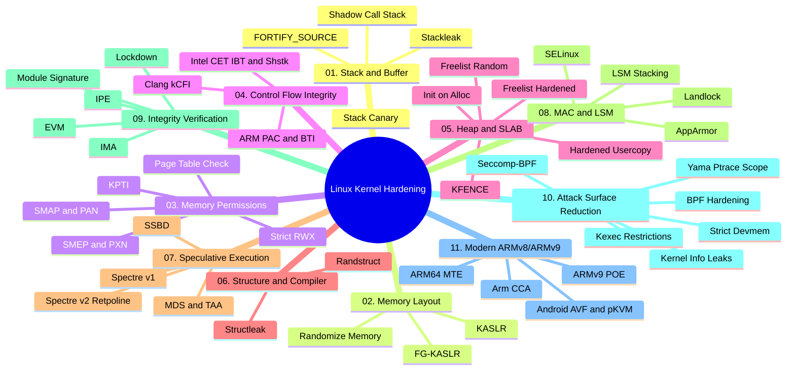

# Hardening Features Taxonomy Roadmap

  
Complete Kernel Hardening Encyclopedia

  

    Complete mapping catalog for all 44 hands-on Linux kernel security hardening features across 11 core categories, detailing Kconfig symbols, target architectures, and verification readiness.
  

  

    11 Hardening Categories
    44 Verified Features
    Kconfig · LKDTM · Exploit PoC
  

---

## 1. Feature Categories Hierarchy

---

## 2. Feature Lab Status (All 44 Features)

### Category 01. Stack & Buffer Protection

| # | Feature Name | Kconfig Symbol | Supported Arch | Status |
| :---: | :--- | :--- | :---: | :---: |
| **01** | [Stack Protector (Canary)](01-stack-protector.md) | `CONFIG_STACKPROTECTOR_STRONG` | x86_64, arm64 | Ready |
| **02** | [FORTIFY_SOURCE](02-fortify-source.md) | `CONFIG_FORTIFY_SOURCE` | x86_64, arm64 | Ready |
| **03** | [Shadow Call Stack (SCS)](03-shadow-call-stack.md) | `CONFIG_SHADOW_CALL_STACK` | arm64 | Ready |
| **04** | [STACKLEAK Plugin](04-stackleak.md) | `CONFIG_GCC_PLUGIN_STACKLEAK` | x86_64, arm64 | Ready |

### Category 02. Memory Layout & Randomization

| # | Feature Name | Kconfig Symbol | Supported Arch | Status |
| :---: | :--- | :--- | :---: | :---: |
| **05** | [KASLR](05-kaslr.md) | `CONFIG_RANDOMIZE_BASE` | x86_64, arm64 | Ready |
| **06** | [FG-KASLR](06-fgkaslr.md) | `CONFIG_FG_KASLR` | x86_64 | Ready |
| **07** | [Randomize Memory](07-randomize-memory.md) | `CONFIG_RANDOMIZE_MEMORY` | x86_64, arm64 | Ready |

### Category 03. Memory Permissions & Access Separation

| # | Feature Name | Kconfig Symbol | Supported Arch | Status |
| :---: | :--- | :--- | :---: | :---: |
| **08** | [Strict Kernel RWX (W^X)](08-strict-rwx.md) | `CONFIG_STRICT_KERNEL_RWX` | x86_64, arm64 | Ready |
| **09** | [SMEP & PXN (ret2usr Defense)](09-smep-pxn.md) | CPU Feature (SMEP / PXN) | x86_64, arm64 | Ready |
| **10** | [SMAP & PAN (User Data Access Prevention)](10-smap-pan.md) | CPU Feature (SMAP / PAN) | x86_64, arm64 | Ready |
| **11** | [Page Table Check](11-page-table-check.md) | `CONFIG_PAGE_TABLE_CHECK` | x86_64, arm64 | Ready |
| **12** | [KPTI (Kernel Page Table Isolation)](12-kpti.md) | `CONFIG_PAGE_TABLE_ISOLATION` | x86_64, arm64 | Ready |

### Category 04. Control Flow Integrity (CFI)

| # | Feature Name | Kconfig Symbol | Supported Arch | Status |
| :---: | :--- | :--- | :---: | :---: |
| **13** | [Clang kCFI](13-kcfi.md) | `CONFIG_CFI_CLANG` | x86_64, arm64 | Ready |
| **14** | [x86 IBT & Shadow Stack (CET)](14-ibt-shstk.md) | `CONFIG_X86_KERNEL_IBT` | x86_64 | Ready |
| **15** | [ARM64 BTI & PAC](15-bti-pac.md) | `CONFIG_ARM64_BTI`, `CONFIG_ARM64_PTR_AUTH` | arm64 | Ready |

### Category 05. Heap & SLAB Allocator Hardening

| # | Feature Name | Kconfig Symbol | Supported Arch | Status |
| :---: | :--- | :--- | :---: | :---: |
| **16** | [SLAB Freelist Hardening](16-slab-freelist.md) | `CONFIG_SLAB_FREELIST_HARDENED` | x86_64, arm64 | Ready |
| **17** | [Heap Zeroing (Alloc & Free)](17-heap-init.md) | `CONFIG_INIT_ON_ALLOC_DEFAULT_ON` | x86_64, arm64 | Ready |
| **18** | [Hardened Usercopy](18-hardened-usercopy.md) | `CONFIG_HARDENED_USERCOPY` | x86_64, arm64 | Ready |
| **19** | [KFENCE (Memory Safety Detector)](19-kfence.md) | `CONFIG_KFENCE` | x86_64, arm64 | Ready |

### Category 06. Structure & Compiler Level Protections

| # | Feature Name | Kconfig Symbol | Supported Arch | Status |
| :---: | :--- | :--- | :---: | :---: |
| **20** | [Structleak Plugin](20-structleak.md) | `CONFIG_GCC_PLUGIN_STRUCTLEAK_BYREF_ALL` | x86_64, arm64 | Ready |
| **21** | [Randstruct Plugin](21-randstruct.md) | `CONFIG_RANDSTRUCT_FULL` | x86_64, arm64 | Ready |

### Category 07. Speculative Execution Defenses

| # | Feature Name | Kconfig Symbol | Supported Arch | Status |
| :---: | :--- | :--- | :---: | :---: |
| **22** | [Spectre v1 (array_index_nospec)](22-spectre-v1.md) | `array_index_nospec` | x86_64, arm64 | Ready |
| **23** | [Spectre v2 (Retpoline, IBPB, STIBP)](23-spectre-v2.md) | `CONFIG_MITIGATION_RETPOLINE` | x86_64, arm64 | Ready |
| **24** | [Speculative Store Bypass Disable (SSBD)](24-ssbd.md) | `CONFIG_MITIGATION_SSB` | x86_64, arm64 | Ready |
| **25** | [MDS & TAA Mitigation (VERW)](25-mds.md) | `CONFIG_MITIGATION_MDS` | x86_64 | Ready |

### Category 08. Mandatory Access Control & LSM Framework

| # | Feature Name | Kconfig Symbol | Supported Arch | Status |
| :---: | :--- | :--- | :---: | :---: |
| **26** | [Stackable LSM Architecture](26-lsm-stacking.md) | `CONFIG_LSM` | x86_64, arm64 | Ready |
| **27** | [AppArmor Process Isolation](27-apparmor.md) | `CONFIG_SECURITY_APPARMOR` | x86_64, arm64 | Ready |
| **28** | [SELinux Type Enforcement](28-selinux.md) | `CONFIG_SECURITY_SELINUX` | x86_64, arm64 | Ready |
| **29** | [Landlock Sandboxing](29-landlock.md) | `CONFIG_SECURITY_LANDLOCK` | x86_64, arm64 | Ready |

### Category 09. System & Binary Integrity Verification

| # | Feature Name | Kconfig Symbol | Supported Arch | Status |
| :---: | :--- | :--- | :---: | :---: |
| **30** | [IMA Integrity Measurement](30-ima.md) | `CONFIG_IMA` | x86_64, arm64 | Ready |
| **31** | [EVM Metadata Protection](31-evm.md) | `CONFIG_EVM` | x86_64, arm64 | Ready |
| **32** | [IPE Policy Enforcement](32-ipe.md) | `CONFIG_SECURITY_IPE` | x86_64, arm64 | Ready |
| **33** | [Kernel Lockdown LSM](33-lockdown.md) | `CONFIG_SECURITY_LOCKDOWN_LSM` | x86_64, arm64 | Ready |
| **34** | [Module Signature Verification](34-module-sig.md) | `CONFIG_MODULE_SIG_FORCE` | x86_64, arm64 | Ready |

### Category 10. Attack Surface Reduction & System Hardening

| # | Feature Name | Kconfig Symbol | Supported Arch | Status |
| :---: | :--- | :--- | :---: | :---: |
| **35** | [Seccomp-BPF Syscall Filtering](35-seccomp.md) | `CONFIG_SECCOMP_FILTER` | x86_64, arm64 | Ready |
| **36** | [BPF Hardening & JIT Blinding](36-bpf-hardening.md) | `CONFIG_BPF_JIT_ALWAYS_ON` | x86_64, arm64 | Ready |
| **37** | [Strict Devmem & Strict I/O](37-strict-devmem.md) | `CONFIG_STRICT_DEVMEM` | x86_64, arm64 | Ready |
| **38** | [Kernel Info Leaks & Dmesg Restrict](38-info-leaks.md) | `CONFIG_SECURITY_DMESG_RESTRICT` | x86_64, arm64 | Ready |
| **39** | [Yama LSM Ptrace Scope](39-yama-ptrace.md) | `CONFIG_SECURITY_YAMA` | x86_64, arm64 | Ready |
| **40** | [Kexec Restrictions & Hardening](40-kexec-restrict.md) | `CONFIG_KEXEC_SIG_FORCE` | x86_64, arm64 | Ready |

### Category 11. Modern ARMv8/ARMv9 & Mobile Security

| # | Feature Name | Kconfig Symbol | Supported Arch | Status |
| :---: | :--- | :--- | :---: | :---: |
| **41** | [ARM64 MTE (Memory Tagging Extension)](41-arm64-mte.md) | `CONFIG_ARM64_MTE` | arm64 | Ready |
| **42** | [ARMv9 POE / S1POE (Permission Overlay)](42-armv9-poe.md) | `CONFIG_ARM64_POE` | arm64 | Ready |
| **43** | [Android Virtualization (AVF / pKVM)](43-avf-pkvm.md) | `CONFIG_KVM` | arm64 | Ready |
| **44** | [Arm CCA (Confidential Compute Architecture)](44-arm-cca.md) | `CONFIG_ARM64_RME` | arm64 | Ready |
