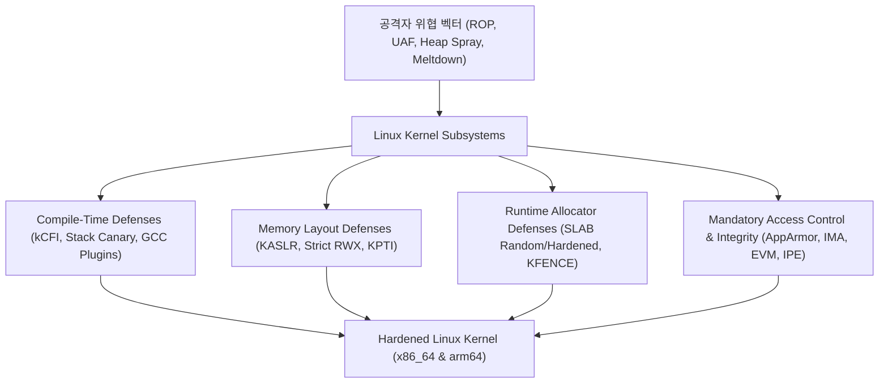

# Linux Kernel Hardening Lab

  
x86_64 &amp; ARM64 Interactive Security Verification Lab

  
리눅스 커널 하드닝 엔지니어링 &amp; 익스플로잇 방어 검증 랩

  

    리눅스 커널 보안 하드닝(Hardening) 기술의 내부 메커니즘을 커널 소스 코드와 어셈블리 레벨에서 심층 분석하고, x86_64 및 arm64 듀얼 아키텍처 QEMU 가상머신 환경에서 실전 Exploit PoC와 LKDTM으로 직접 실측 검증하는 엔지니어링 랩.
  

  

    <a href="getting-started/" class="lab-btn lab-btn--primary">실습 환경 시작하기 →</a>
    <a href="features/" class="lab-btn lab-btn--secondary">44대 하드닝 피처 로드맵</a>
    <a href="scenarios/" class="lab-btn lab-btn--secondary">공격 시나리오 분석</a>
  

  

    

      
44+ Features

      
11대 핵심 하드닝 카테고리 및 Kconfig 전수 분석

    

    

      
x86_64 &amp; ARM64

      
Intel CET/SMEP/SMAP 및 ARM PAC/BTI/MTE 교차 비교

    

    

      
Base vs Hardened

      
실전 익스플로잇 PoC 및 LKDTM 런타임 방어 증명

    

    

      
Interactive Flow

      
동적 SVG 아키텍처 시뮬레이터 기반 제어 흐름 탐색

    

  

---

## 1. 랩의 구성 및 설계 철학

- **이론과 실제 바이너리 검증의 유기적 결합**:
  - 보안 기능의 Kconfig 정의 및 커널 소스 코드 레벨 분석.
  - 보안 옵션 비활성화(Base) 상태와 활성화(Hardened) 상태의 커널 빌드 및 동작 비교.
  - LKDTM(Linux Kernel Dump Test Module) 및 맞춤형 Exploit PoC를 통한 방어 메커니즘 런타임 증명.
- **x86_64 및 arm64(aarch64) 듀얼 아키텍처 동시 지원**:
  - 인텔/AMD 환경의 하드웨어 보안 기술(CET IBT/SHSTK, SMEP, SMAP)과 ARM 환경의 보안 기술(PAC, BTI, PAN, PXN) 비교 실습.
- **엔지니어링 표준 준수**:
  - 간결하고 명확한 개조식 명사 종결형 문체 적용.
  - 다이어그램 중심의 직관적 아키텍처 설명 제공.

---

## 2. 11대 핵심 하드닝 카테고리 로드맵

| 카테고리 | 핵심 메커니즘 | 주요 Kconfig 및 대표 피처 |
| :--- | :--- | :--- |
| [**1. Stack & Buffer**](features/index.md#category-01-stack-buffer-protection) | 함수 스택 프레임 무결성 검증 및 버퍼 경계 검사 | [`Stack Protector`](features/01-stack-protector.md), [`FORTIFY_SOURCE`](features/02-fortify-source.md) |
| [**2. Memory Layout**](features/index.md#category-02-memory-layout-randomization) | 커널 텍스트, 모듈, 물리 메모리 배치 난수화 | [`KASLR`](features/05-kaslr.md), [`FG-KASLR`](features/06-fgkaslr.md) |
| [**3. Memory Permissions**](features/index.md#category-03-memory-permissions-access-separation) | W^X 메모리 보호, 유저/커널 영역 간 불법 실행·접근 차단 | [`Strict RWX`](features/08-strict-rwx.md), [`SMEP/PXN`](features/09-smep-pxn.md) |
| [**4. Control Flow Integrity**](features/index.md#category-04-control-flow-integrity) | 컴파일 타임 및 하드웨어 지원 간접 분기 추적 | [`Clang kCFI`](features/13-kcfi.md), [`Intel CET`](features/14-ibt-shstk.md) |
| [**5. Heap & SLAB Hardening**](features/index.md#category-05-heap-slab-allocator-hardening) | 힙 메타데이터 난독화, UAF 방지 자동 영(0) 초기화 | [`SLAB Freelist`](features/16-slab-freelist.md), [`KFENCE`](features/19-kfence.md) |
| [**6. Compiler Plugins**](features/index.md#category-06-structure-compiler-level-protections) | 구조체 레이아웃 난수화, 스택 잔여 데이터 자동 소거 | [`Randstruct`](features/21-randstruct.md), [`STACKLEAK`](features/04-stackleak.md) |
| [**7. Speculative Mitigations**](features/index.md#category-07-speculative-execution-defenses) | CPU 투기적 실행 결함(Spectre, Meltdown) 소프트웨어 완화 | [`Spectre v1`](features/22-spectre-v1.md), [`Spectre v2`](features/23-spectre-v2.md) |
| [**8. Access Control (LSM)**](features/index.md#category-08-lsm-mac-lsm-framework) | 프로세스 단위 강제적 접근 통제 및 샌드박싱 | [`AppArmor`](features/27-apparmor.md), [`SELinux`](features/28-selinux.md) |
| [**9. Integrity Verification**](features/index.md#category-09-system-binary-integrity) | 파일 실행 무결성 해시 측정, xattr 서명, 정책 집행 | [`IMA`](features/30-ima.md), [`Lockdown`](features/33-lockdown.md) |
| [**10. Attack Surface Reduction**](features/index.md#category-10-attack-surface-reduction) | 시스템 콜 필터링, 임의 메모리 접근 및 정보 누출 차단 | [`Seccomp-BPF`](features/35-seccomp.md), [`Strict Devmem`](features/37-strict-devmem.md) |
| [**11. Modern ARM & Mobile**](features/index.md#category-11-armv8armv9-modern-armv8armv9-mobile-security) | 하드웨어 메모리 태깅, 권한 오버레이, pKVM 및 기밀 컴퓨팅 | [`ARM64 MTE`](features/41-arm64-mte.md), [`ARMv9 POE`](features/42-armv9-poe.md) |

---

## 3. 학습 진행 방식

1. [Quick Start](getting-started/index.md): 커널 빌드 도구 및 QEMU 에뮬레이터 환경 구축.
2. [Dual-Arch Environment](getting-started/dual-arch.md): x86_64 및 aarch64 교차 컴파일 및 실행 환경 검증.
3. [Architecture](architecture/index.md): 커널 메모리 모델 및 특권 레벨 전환 메커니즘 확인.
4. [Features Roadmap](features/index.md): 개별 하드닝 피처별 단계적 실습 및 로그 분석.
