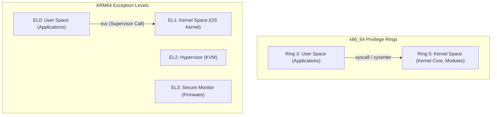
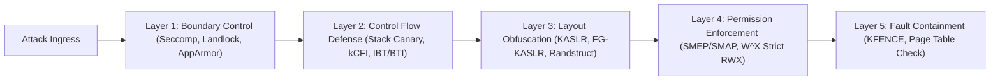

import { Aside, Badge } from '@astrojs/starlight/components';

  
Hardware Privilege &amp; Memory Isolation

  

    Analysis of hardware privilege levels across x86_64 (Ring 0–3) and arm64 (EL0–EL3), 64-bit virtual address space splitting, and the 5-layer defense-in-depth kernel hardening architecture.
  

  

    <Badge text="x86_64 Ring 0 / Ring 3" variant="tip" />
    <Badge text="ARM64 EL0–EL3 &amp; TTBR0/1" variant="note" />
    <Badge text="5-Layer Defense-in-Depth" variant="success" />
  

---

## 1. Privilege Level Model Comparison

<Aside type="note" title="Distinction Between UID 0 (root) and Ring 0">
  Processes executing under the root account (UID 0) remain confined within unprivileged user mode (Ring 3 / EL0) from the CPU hardware perspective. For a deep architectural comparison between rooting and Ring 0 kernel control, see [Scenarios Overview: Rooting vs Kernel Space Security Boundary](../scenarios/index.md#security-boundary-root-vs-kernel).
</Aside>
---

## 2. 64-bit Virtual Address Space Splitting

### 2.1 x86_64 (48-bit / 4-Level Paging)

- `0x0000_0000_0000_0000` ~ `0x0000_7FFF_FFFF_FFFF` (128TB): **User Space**
- `0x0000_8000_0000_0000` ~ `0xFFFF_7FFF_FFFF_FFFF`: Non-canonical hole
- `0xFFFF_8000_0000_0000` ~ `0xFFFF_FFFF_FFFF_FFFF` (128TB): **Kernel Space**
  - Direct mapping (physical memory identity map)
  - vmalloc / ioremap ranges
  - Modules and Kernel Text (`CONFIG_RANDOMIZE_BASE` randomization target)

### 2.2 ARM64 (48-bit VA, TTBR0 vs TTBR1)

- `0x0000_0000_0000_0000` ~ `0x0000_FFFF_FFFF_FFFF`: **TTBR0_EL1** (User Space)
- `0xFFFF_0000_0000_0000` ~ `0xFFFF_FFFF_FFFF_FFFF`: **TTBR1_EL1** (Kernel Space)
- Hardware base registers split lower and upper address spaces directly.

---

## 3. Defense-in-Depth Architecture

